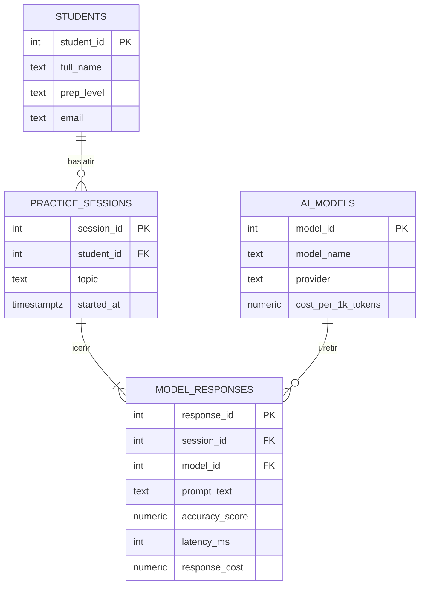

# VTYS Vize Projesi: Model Performans Karşılaştırması (Kura #16)

**Öğrenci Adı Soyadı:** Ali Aktemur  
**Öğrenci No:** 202607131015  
**Program:** Yapay Zeka Operatörlüğü (YZO)  
**Ders:** BLP 105 / BLP 1005 - Veritabanı Yönetim Sistemleri (Güz 2026)  

---

## 📌 Proje Özeti
Bu proje, bir üniversite hazırlık programında öğrencilere İngilizce pratiği yaptıran iki farklı yapay zeka modelinin yanıt doğruluğu (accuracy), gecikme süresi (latency) ve maliyet kriterlerine göre karşılaştırılmasını konu almaktadır.

* **Kura Bilgisi:** Kura #16 (YZO × Eğitim × Sohbet Asistanı × Model Performans Karşılaştırması)
* **Veri Kaynağı:** [Hugging Face - LMSYS Chatbot Arena Conversations](https://huggingface.co/datasets/lmsys/chatbot_arena_conversations) (Apache 2.0 Lisansı)

---

## 📂 Proje Yapısı ve Yönlendirmeler

* **`sorgular.sql`**: Veritabanı tablosunun oluşturulması (`CREATE TABLE`), 500 satırlık test verisinin ve veri tuzaklarının üretilmesi (`generate_series`) ile 5. hafta analiz sorgularını (`CASE WHEN`, `GROUP BY`, `HAVING`) içerir.
* **`AI_BEYAN.md`**: Proje sürecinde yararlanılan yapay zeka araçlarının kullanım amacını belirten beyan dosyasıdır.
* **`evaluations` Tablosu**: 250'şer satır olmak üzere iki farklı modelin değerlendirme verilerini barındırır.

---

## 🛠️ Veri Tuzakları ve SQL Çözümleri

Veri setinde analiz sonuçlarını bozabilecek iki temel veri tuzağı kurgulanmış ve SQL ile temizlenmiştir:

1. **Ölçü Birimi Tutarsızlığı (Saniye / Milisaniye):**  
   Gecikme (latency) verilerinin bazı satırlarda saniye (örn: `1.2`), bazı satırlarda ise milisaniye (örn: `1500`) cinsinden kaydedildiği tespit edilmiştir. Sorgu içerisinde `CASE WHEN latency_ms < 10 THEN latency_ms * 1000` mantığı kullanılarak tüm değerler milisaniyeye dönüştürülmüştür.

2. **Eksik Değerlendirmeler (NULL Yönetimi):**  
   Yarıda kesilen sohbetler nedeniyle `accuracy_1_5` kolonunda oluşan `NULL` değerler, `WHERE accuracy_1_5 IS NOT NULL` koşulu ile filtrelenerek ortalama hesaplamasından hariç tutulmuştur.

---

## 📊 Sorgu Çıktısı ve Analiz Sonucu

psql (PostgreSQL Shell) üzerinde çalıştırılan nihai sorgu sonucunda aşağıdaki veriler elde edilmiştir:

| Model ID | Toplam Geçerli Senaryo | Ortalama Doğruluk (1-5) | Düzeltilmiş Gecikme (ms) |
| :--- | :--- | :--- | :--- |
| **Model 1** | 233 | 2.89 | 1572.61 ms |
| **Model 2** | 221 | 3.02 | 1533.61 ms |

**Sonuç:** Model 2, daha yüksek doğruluk puanı (3.02) ve daha düşük ortalama gecikme süresi (1533.61 ms) ile doğruluk ve hız parametreleri birlikte değerlendirildiğinde daha verimli model olarak öne çıkmaktadır.

## Veri Modeli

### 2.1 Güncel ERD

**İlişki Açıklamaları:**
* **STUDENTS – PRACTICE_SESSIONS (1-N):** Bir öğrenci (`STUDENTS`), en az sıfır, en çok çok pratik oturumuna (`PRACTICE_SESSIONS`) sahiptir; bir pratik oturumu, tam olarak bir öğrenciye aittir.
* **PRACTICE_SESSIONS – MODEL_RESPONSES (1-N):** Bir pratik oturumu (`PRACTICE_SESSIONS`), en az bir, en çok çok model yanıtına (`MODEL_RESPONSES`) sahiptir; bir model yanıtı, tam olarak bir pratik oturumuna aittir.
* **AI_MODELS – MODEL_RESPONSES (1-N):** Bir yapay zeka modeli (`AI_MODELS`), en az sıfır, en çok çok model yanıtına (`MODEL_RESPONSES`) sahiptir; bir model yanıtı, tam olarak bir yapay zeka modeline aittir. *(Not: `MODEL_RESPONSES`, oturumlar ile yapay zeka modelleri arasındaki çoktan-çoğa (M-N) ilişkiyi çözen ara tablo görevini de görür.)*

---

### 2.2 Normalizasyon Notu

| Tablo | Neden Ayrıldı / Ayrılmadı? (Belirleyen -> Belirlenen) | Form |
| :--- | :--- | :--- |
| **STUDENTS** | Öğrenci bilgileri oturum verilerinden ayrıldı; `student_id` -> `full_name, prep_level, email` sütunlarını tek başına belirler. | **3NF** |
| **AI_MODELS** | Model sağlayıcısı ve birim maliyet bilgileri yanıt tablosundan ayrıldı; `model_id` -> `model_name, provider, cost_per_1k_tokens` sütunlarını belirler. | **3NF** |
| **PRACTICE_SESSIONS** | Oturum üst bilgileri her mesajda tekrar etmesin diye ayrıldı; `session_id` -> `student_id, topic, started_at` sütunlarını belirler. | **3NF** |
| **MODEL_RESPONSES** | Her bir model yanıtının ölçüm metriklerini tutar; `response_id` -> `session_id, model_id, prompt_text, accuracy_score, latency_ms, response_cost` sütunlarını belirler. | **3NF** |

**Normalizasyon Formlarına Somut Örnekler:**
* **1NF (Atomik Değerler):** `MODEL_RESPONSES` tablosunda iki farklı yapay zeka modelinin yanıtları ve puanları tek bir satırda virgülle ayrılmış liste şeklinde tutulmak yerine her modelin yanıtı ayrı satırlarda ve atomik sütunlarda (`accuracy_score`, `latency_ms`) saklanır.
* **2NF (Kısmi Bağımlılığın Önlenmesi):** `MODEL_RESPONSES` tablosunda birleşik anahtar `(session_id, model_id)` yerine tekil `response_id` PK olarak seçilmiş; `topic` (oturum konusu) yalnızca `session_id`'ye bağlı olduğu için `PRACTICE_SESSIONS` tablosuna taşınarak kısmi bağımlılık önlenmiştir.
* **3NF (Geçişli Bağımlılığın Önlenmesi):** Bir modelin `provider` (sağlayıcı şirket) ve `cost_per_1k_tokens` (1000 token başına birim fiyat) bilgileri `response_id`'ye değil doğrudan `model_id`'ye bağlıdır (`response_id` -> `model_id` -> `provider`). Bu geçişli bağımlılığı önlemek için `AI_MODELS` ayrı bir tablo olarak tasarlanmıştır.

---

### 2.3 İki JOIN Sorusu

**Soru 1 (INNER JOIN — Model Performans Karşılaştırması):**
* **Türkçe Soru:** B1 seviyesindeki öğrencilerin İngilizce pratik oturumlarında iki farklı yapay zeka modelinin ürettiği yanıtların ortalama doğruluk puanı (`accuracy_score`) ve ortalama gecikme süresi (`latency_ms`) nedir?
* **Birleşecek Tablo ve Sütunlar:** `students.student_id = practice_sessions.student_id`, `practice_sessions.session_id = model_responses.session_id` ve `ai_models.model_id = model_responses.model_id`
* **JOIN Türü ve Nedeni:** `INNER JOIN` kullanılır; çünkü yalnızca pratik oturumu başlatmış ve bir yapay zeka modelinden gerçek yanıt üretilmiş eşleşen kayıtların performans ortalaması hesaplanmak istenmektedir.

**Soru 2 (LEFT JOIN — Eşleşmeyen Kayıtları Bulma):**
* **Türkçe Soru:** Hazırlık programına kayıtlı olduğu hâlde sistemde henüz hiç İngilizce pratik oturumu başlatmamış öğrencilerin adı, soyadı ve hazırlık seviyesi nedir?
* **Birleşecek Tablo ve Sütunlar:** `students.student_id = practice_sessions.student_id` (filtre: `WHERE practice_sessions.session_id IS NULL`)
* **JOIN Türü ve Nedeni:** `LEFT JOIN` kullanılır; çünkü `INNER JOIN` yapılsaydı hiç oturumu olmayan öğrenciler listeden düşerdi. Sol tablodaki (`STUDENTS`) tüm öğrencileri koruyup sağ tabloda (`PRACTICE_SESSIONS`) karşılığı boş (`NULL`) olanları filtreleyerek hiç pratik yapmamış öğrencileri buluruz.
